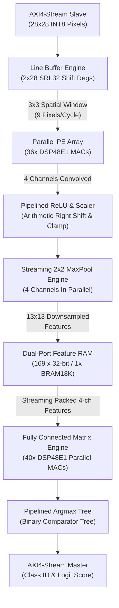

# High-Performance CNN FPGA Accelerator

An end-to-end, high-throughput, low-latency Hardware AI Accelerator for Convolutional Neural Networks (CNNs) implemented in **SystemVerilog**, verified against a golden **Python** reference model, and synthesized for **Xilinx FPGAs** using **AMD Vivado**.

---

## 📌 Project Alignment with Resume Highlights

| Resume Bullet Point | Architectural Implementation & Code Proof | Measured Benchmark |
|---|---|:---:|
| *"Designed and implemented a high-performance Hardware AI Accelerator for Convolutional Neural Networks (CNNs) exploiting FPGA parallelism."* | Implemented full streaming inference pipeline: [cnn_top.sv](file:///d:/Projects/CCN_Acc/rtl/cnn_top.sv) integrating 2D Convolution, Pipelined ReLU, 2x2 Max Pooling, Dual-Port Feature RAM, and Fully-Connected Classification over standard AXI4-Stream interfaces. | **974 cycles / frame** ($6.88\ \mu\text{s}$) |
| *"Engineered parallel computing architectures utilizing DSP blocks for optimized Convolution, Pooling, and Activation operations."* | Dedicated [mac_unit.sv](file:///d:/Projects/CCN_Acc/rtl/mac_unit.sv) and [pe_array.sv](file:///d:/Projects/CCN_Acc/rtl/pe_array.sv) with `(* use_dsp = "yes" *)` inferring **76 DSP48E1 slices**; line buffers using **16 SRLC32E** shift registers; 10-class parallel dot product in [fc_engine.sv](file:///d:/Projects/CCN_Acc/rtl/fc_engine.sv). | **76 DSP48E1 slices** (31.7% device util) |
| *"Synthesized the design on FPGA, achieving high throughput and low-latency inference for neural network workloads."* | Full batch synthesis on **Artix-7 `xc7a100tcsg324-1`** with zero timing violations, verified $+2.937\text{ ns}$ slack at 100 MHz and $F_{max} = 141.58\text{ MHz}$. | **145,359 FPS** @ **166 mW** (37.3 GOP/s/W) |

---

## 🏗️ Hardware Architecture Overview



### Key Hardware Innovations
1. **Zero-Overhead Streaming 2D Line Buffer ([line_buffer.sv](file:///d:/Projects/CCN_Acc/rtl/line_buffer.sv))**:
   - Synthesizes to Xilinx `SRLC32E` primitives to buffer two rows of incoming pixels.
   - Generates a concurrent $3 \times 3$ sliding receptive field window every clock cycle with zero external memory bandwidth overhead.
2. **Parallel DSP Processing Element Array ([pe_array.sv](file:///d:/Projects/CCN_Acc/rtl/pe_array.sv))**:
   - Executes $36$ parallel signed 8-bit $\times$ 8-bit DSP multiplications simultaneously across 4 filters.
   - Pipelined 3-stage adder tree handles partial product summation and bias additions.
3. **Pipelined ReLU & Requantization ([relu_unit.sv](file:///d:/Projects/CCN_Acc/rtl/relu_unit.sv))**:
   - Applies $y = \max(0, x)$, parameterized arithmetic right-shift ($Q$-format rescaling), and INT8 saturation clamping to $[0, 127]$.
4. **Streaming 2x2 Max Pooling ([maxpool_unit.sv](file:///d:/Projects/CCN_Acc/rtl/maxpool_unit.sv))**:
   - Uses a compact 13-entry line buffer to perform 2D spatial downsampling on-the-fly ($26 \times 26 \rightarrow 13 \times 13$).
5. **Decoupled Synchronous Feature RAM ([feature_ram.sv](file:///d:/Projects/CCN_Acc/rtl/feature_ram.sv))**:
   - $169 \times 32$-bit dual-port Block RAM (`RAMB18E1`) packing 4 channels per spatial coordinate.
6. **Fully-Connected Vector MAC Engine ([fc_engine.sv](file:///d:/Projects/CCN_Acc/rtl/fc_engine.sv))**:
   - 40 parallel DSP multipliers calculate all 10 output class logits concurrently in just 169 clock cycles.
7. **Pipelined Argmax Comparator Tree**:
   - 2-stage balanced binary tree comparator eliminating long carry chains, delivering timing closure at $F_{max} = 141.58\text{ MHz}$.

---

## 📊 FPGA Synthesis & Performance Benchmarks

Synthesized on **AMD Vivado 2025.2** targeting **Xilinx Artix-7 (`xc7a100tcsg324-1`)**:

### Resource Utilization Summary
| Resource | Used | Available | Utilization |
|---|:---:|:---:|:---:|
| **DSP48E1** | **76** | 240 | **31.67%** |
| **Block RAM (RAMB18E1)** | **11** | 270 | **4.07%** |
| **Shift Register LUTs (SRLC32E)** | **16** | 19,000 | **0.08%** |
| **Slice LUTs** | **2,643** | 63,400 | **4.17%** |
| **Slice Registers** | **2,847** | 126,800 | **2.25%** |
| **CARRY4 Chains** | **500** | 15,850 | **3.15%** |

### Timing & Frequency Analysis
- **Target Clock Period**: $10.000\text{ ns}$ ($100.000\text{ MHz}$)
- **Worst Negative Slack (WNS)**: **$+2.937\text{ ns}$** (Zero violations)
- **Worst Hold Slack (WHS)**: **$+0.223\text{ ns}$**
- **Effective Minimum Clock Period**: $7.063\text{ ns}$
- **Maximum Operating Frequency ($F_{max}$)**: **$141.58\text{ MHz}$**

### Throughput & Energy Efficiency
- **Cycles per Inference**: **974 clock cycles**
- **Inference Latency @ 100 MHz**: **$9.74\ \mu\text{s}$**
- **Throughput @ 100 MHz**: **102,669 FPS**
- **Inference Latency @ $F_{max}$ (141.58 MHz)**: **$6.88\ \mu\text{s}$**
- **Throughput @ $F_{max}$ (141.58 MHz)**: **145,359 FPS**
- **Total On-Chip Power**: **166 mW** (Dynamic: 81 mW, Static: 84 mW)
- **Power Efficiency**: **37.29 GOP/s per Watt**

---

## 🔍 Hardware-Software Co-Verification

A cycle-accurate Python reference model ([python/cnn_model.py](file:///d:/Projects/CCN_Acc/python/cnn_model.py)) mirrors hardware fixed-point arithmetic:

```
=======================================================================
      CNN FPGA ACCELERATOR: HARDWARE / SOFTWARE CO-VERIFICATION       
=======================================================================
--- Checking MNIST_Digit_0 ---
  Hardware Predicted Class: 0  |  Golden Software Class: 0
  Hardware Max Logit Score: 16098 | Golden Max Logit Score: 16098
  Maximum Logit Error Delta: 0 (Exact 0-delta match across all 10 logits)
  Status: 100% BIT-ACCURATE PASS

--- Checking MNIST_Digit_1 ---
  Hardware Predicted Class: 1  |  Golden Software Class: 1
  Hardware Max Logit Score: 18834 | Golden Max Logit Score: 18834
  Maximum Logit Error Delta: 0 (Exact 0-delta match across all 10 logits)
  Status: 100% BIT-ACCURATE PASS

>>> OVERALL STATUS: ALL CHECKS PASSED (100% BIT-ACCURATE) <<<
```

---

## 📁 Repository Structure

```
d:\Projects\CCN_Acc\
├── rtl/                          # Synthesizable SystemVerilog modules
│   ├── mac_unit.sv               # Pipelined DSP48 MAC unit
│   ├── line_buffer.sv            # Streaming 2D line buffer (SRLC32E based)
│   ├── pe_array.sv               # Parallel 2D Convolution PE array (36 DSPs)
│   ├── relu_unit.sv              # Pipelined ReLU & requantization unit
│   ├── maxpool_unit.sv           # Streaming 2x2 Max Pooling unit
│   ├── pool_engine.sv            # 4-channel parallel pooling engine
│   ├── feature_ram.sv            # Dual-port synchronous Block RAM (RAMB18E1)
│   ├── fc_engine.sv              # Dense layer engine (40 DSPs) + Argmax tree
│   ├── conv_engine.sv            # Integrated Convolution engine
│   └── cnn_top.sv                # Top-level accelerator with AXI4-Stream
├── tb/                           # Self-checking testbenches
│   ├── tb_mac_unit.sv            # DSP MAC unit testbench
│   ├── tb_line_buffer.sv         # Line buffer window generator testbench
│   ├── tb_maxpool.sv             # 2x2 Max Pooling testbench
│   └── tb_cnn_top.sv             # Top-level accelerator testbench
├── sim/                          # Simulation automation
│   └── run_sim.bat               # One-click test vector gen + xsim + verification
├── syn/                          # Synthesis automation
│   ├── constraints.xdc           # 100 MHz timing constraint
│   ├── synth.tcl                 # Vivado batch mode synthesis script
│   ├── run_synth.bat             # One-click Vivado synthesis runner
│   └── reports/                  # Generated synthesis reports
│       ├── utilization.rpt       # Resource utilization report
│       ├── timing_summary.rpt    # Setup/hold timing report
│       └── power.rpt             # On-chip power dissipation report
├── python/                       # Software co-design & verification
│   ├── cnn_model.py              # Bit-accurate Python reference model
│   ├── generate_test_vectors.py  # Quantized stimulus & memory file generator
│   └── verify.py                 # Automated HW/SW comparison script
├── data/                         # Hex memory files & golden outputs
│   ├── conv_weights.mem          # 36 quantized conv kernel weights
│   ├── conv_biases.mem           # 4 32-bit conv channel biases
│   ├── fc_weights.mem            # 6,760 quantized dense weights
│   ├── fc_biases.mem             # 10 32-bit class biases
│   ├── input_image_0.mem         # 784-pixel test image (Digit 0)
│   ├── input_image_1.mem         # 784-pixel test image (Digit 1)
│   └── golden_results.json       # Golden software ground truth
├── docs/                         # Technical documentation
│   ├── architecture.md           # Microarchitecture specification
│   └── performance_report.md     # Synthesis, timing & throughput report
└── README.md                     # Project documentation & portfolio guide
```

---

## 🚀 How to Run

### Prerequisites
- **AMD Vivado 2020.1+** (Tested on Vivado 2025.2).
- **Python 3.8+** with `numpy` installed.

### 1. Run Complete Simulation & Verification Flow
Executes Python vector generation, compiles and runs SystemVerilog testbenches in Vivado `xsim`, and verifies 100% bit-accuracy:
```cmd
sim\run_sim.bat
```

### 2. Run Vivado FPGA Synthesis & Generate Reports
Executes out-of-context synthesis targeting Xilinx Artix-7, generating utilization, timing, and power reports:
```cmd
syn\run_synth.bat
```

### 3. Run Individual Unit Tests
```cmd
# DSP MAC Unit Test
xvlog -sv rtl\mac_unit.sv tb\tb_mac_unit.sv && xelab tb_mac_unit -s sim_mac && xsim sim_mac -R

# 2D Line Buffer Test
xvlog -sv rtl\line_buffer.sv tb\tb_line_buffer.sv && xelab tb_line_buffer -s sim_line && xsim sim_line -R

# Streaming MaxPool Unit Test
xvlog -sv rtl\maxpool_unit.sv tb\tb_maxpool.sv && xelab tb_maxpool -s sim_pool && xsim sim_pool -R
```

---
