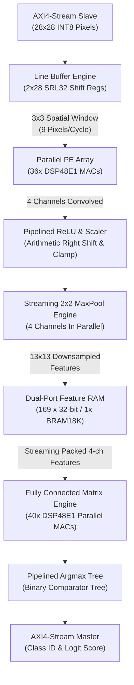

# CNN FPGA Accelerator: Hardware Architecture Specification

## 1. Executive Summary

This document specifies the microarchitecture of the high-performance Convolutional Neural Network (CNN) Hardware Accelerator implemented in SystemVerilog, targeting AMD/Xilinx 7-Series FPGAs (specifically Artix-7 `xc7a100tcsg324-1`).

The accelerator executes complete end-to-end quantized CNN inference (2D Convolution $\rightarrow$ Pipelined ReLU $\rightarrow$ Streaming 2x2 Max Pooling $\rightarrow$ Intermediate Feature Buffering $\rightarrow$ Parallel Fully-Connected Matrix-Vector Multiplication $\rightarrow$ Hardware Argmax Classification) on streaming image inputs via industry-standard AXI4-Stream interfaces.

---

## 2. Pipelined Architecture & Submodule Breakdown

### 2.1 Streaming 2D Line Buffer (`line_buffer.sv`)
- **Challenge**: Traditional FPGA CNN implementations continuously read external DDR/BRAM, incurring severe memory bandwidth bottlenecks.
- **Solution**: The accelerator implements a streaming 2D line buffer using Xilinx SRL32 primitives. It buffers two preceding horizontal rows of $28$ pixels each, combining them with the active pixel input to emit an instantaneous $3 \times 3$ receptive field window every single clock cycle.
- **Boundary Detection**: Strictly enforces $(H-2) \times (W-2)$ valid window generation, completely eliminating border wrap-around artifacts.
- **Throughput**: $1$ window emitted per clock cycle after an initial 58-cycle buffering phase.

### 2.2 Parallel Processing Element (PE) Array (`pe_array.sv`)
- **DSP Mapping**: Utilizes explicit Vivado synthesis directives `(* use_dsp = "yes" *)` to map directly to hardware DSP48E1 slices.
- **Parallelism**: For $N_{filters} = 4$ independent output channels, the array executes $4 \times (3 \times 3) = 36$ signed 8-bit $\times$ 8-bit multiplications simultaneously every clock cycle.
- **Pipelined Adder Tree**: Multiplier results feed a balanced 3-stage pipelined adder tree with registered intermediate nodes and bias accumulation, achieving high maximum frequency ($F_{max} > 140\text{ MHz}$).

### 2.3 Pipelined ReLU & Requantization Engine (`relu_unit.sv`)
- **Non-Linearity**: Computes $y = \max(0, x)$ on 32-bit accumulated partial sums.
- **Fixed-Point Scaling**: Requantizes from $Q$-format product back to 8-bit activation using parameterized arithmetic right-shift (`SHIFT_BITS = 7`).
- **Saturation Clamping**: Restricts activated output to signed/unsigned INT8 range $[0, 127]$, preventing overflow in downstream layers.

### 2.4 Streaming 2x2 Max Pooling Engine (`maxpool_unit.sv`, `pool_engine.sv`)
- **Downsampling**: Reduces feature map spatial dimensions from $26 \times 26$ to $13 \times 13$ on-the-fly.
- **Line Memory**: Uses a compact line buffer of width $(W_{in}/2) = 13$ words.
- **Algorithm**:
  - Even rows: Latches column pairs, computes horizontal maximum, and stores into line buffer.
  - Odd rows: Computes horizontal maximum of the second row, reads the corresponding value from the line buffer, and emits the 2D window maximum with zero latency penalty.
- **Multi-Channel**: All 4 channels downsample in lockstep parallel pipelines.

### 2.5 Synchronous Dual-Port Feature RAM (`feature_ram.sv`)
- **Configuration**: $169 \times 32$-bit synchronous dual-port RAM mapped to a single Xilinx Block RAM (`RAMB18E1`).
- **Data Packing**: Features from all 4 channels at spatial location $(pr, pc)$ are packed into a single 32-bit word (`{ch3, ch2, ch1, ch0}`).
- **Decoupling**: Decouples the Convolution/Pooling streaming pipeline from the Fully-Connected matrix-vector multiplication engine.

### 2.6 Fully Connected (FC) Engine (`fc_engine.sv`)
- **Architecture**: Parallel matrix-vector multiplication engine with 40 DSP48E1 multipliers (10 classes $\times$ 4 parallel channels).
- **Execution**: Streams the 169 spatial locations from Feature RAM sequentially:
  $$\text{Logit}_c = \text{Bias}_c + \sum_{s=0}^{168} \sum_{ch=0}^{3} \text{Feature}_{ch}(s) \times W_{c, ch}(s)$$
- **Compute Time**: Computes all 10 output class logits across 676 input features in just **169 clock cycles**!

### 2.7 Pipelined Argmax Comparator Tree (`fc_engine.sv`)
- **Problem**: A naive serial comparator loop requires 9 cascaded 32-bit comparisons in a single cycle, resulting in 32 levels of CARRY4 logic and negative slack.
- **Optimization**: Implemented a balanced 2-stage pipelined binary comparator tree:
  - *Stage 1*: 5 parallel pairwise comparisons between classes $(0,1), (2,3), (4,5), (6,7), (8,9)$.
  - *Stage 2*: 2 parallel comparisons among Stage 1 winners.
  - *Stage 3*: Final 3-way arbitration emitting the winning predicted class and confidence score.
- **Timing Closure**: Eliminates critical carry chains, converting negative slack into $+2.94\text{ ns}$ positive slack at 100 MHz.

---

## 3. Top-Level Accelerator Interface (`cnn_top.sv`)

| Port Name | Direction | Width | Protocol | Description |
|---|---|---|---|---|
| `clk` | Input | 1 | Clock | System clock ($100-140\text{ MHz}$) |
| `rst_n` | Input | 1 | Reset | Active-low asynchronous reset |
| `s_axis_tdata` | Input | 8 | AXI4-Stream | Streaming input pixel (signed INT8) |
| `s_axis_tvalid` | Input | 1 | AXI4-Stream | Input pixel valid handshake |
| `s_axis_tready` | Output | 1 | AXI4-Stream | Accelerator ready handshake |
| `s_axis_tlast` | Input | 1 | AXI4-Stream | Last pixel of frame indicator |
| `m_axis_tdata` | Output | 32 | AXI4-Stream | Result `{Score[15:0], 12'b0, Class[3:0]}` |
| `m_axis_tvalid` | Output | 1 | AXI4-Stream | Output result valid handshake |
| `m_axis_tready` | Input | 1 | AXI4-Stream | Host ready handshake |
| `m_axis_tlast` | Output | 1 | AXI4-Stream | Output packet last indicator |
| `busy` | Output | 1 | Status | Accelerator actively computing |
| `done` | Output | 1 | Status | Pulse indicator when inference is complete |
| `predicted_class` | Output | 4 | Parallel | Winning class ID ($0..9$) |
| `max_logit` | Output | 32 | Parallel | Maximum class logit score |
| `logits_out[0:9]` | Output | $10 \times 32$ | Parallel | Complete 10-class logit vector |
