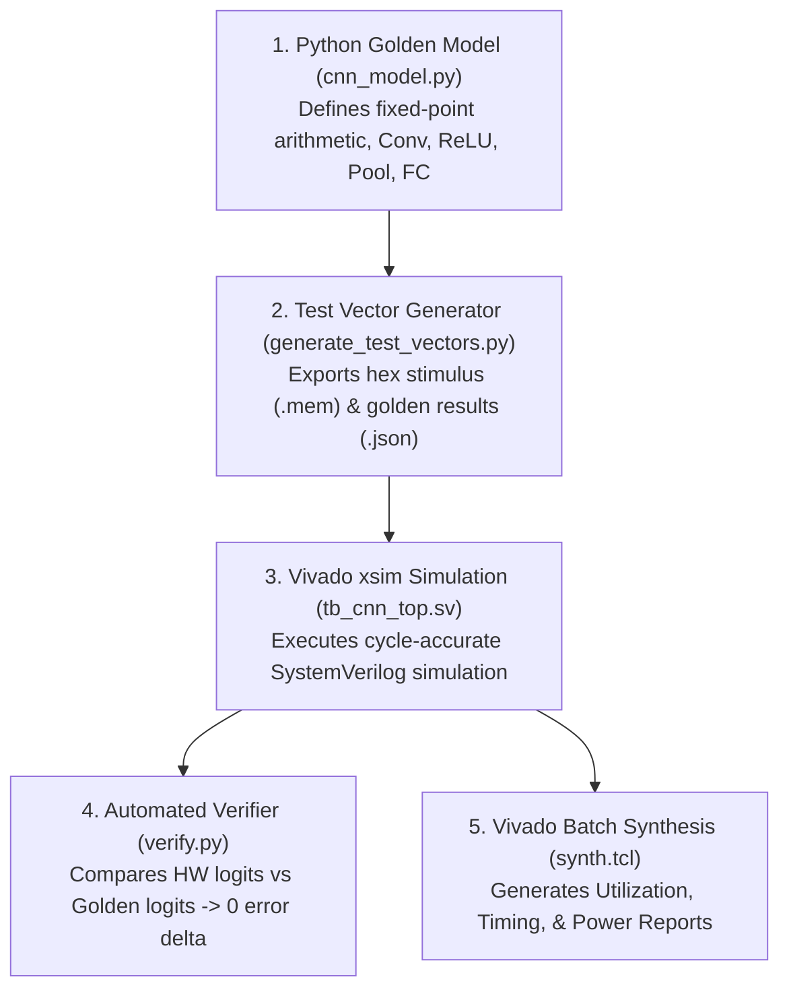

# CNN FPGA Accelerator: Comprehensive Presentation & Defense Guide

> **Target Audience**: Technical Interviewers (FPGA / RTL / ASIC / AI Hardware), Academic Evaluators, and Engineering Managers.
> **Key Objective**: Equip you with structured talking points, technical depth, design trade-off rationales, and exact benchmark figures to convey the project with authority.

---

## 1. Executive Summary & Pitch Scripts

### 🎙️ The 30-Second Elevator Pitch
> *"I designed, implemented, and synthesized an end-to-end quantized CNN Hardware Accelerator on an AMD/Xilinx Artix-7 FPGA using SystemVerilog. The architecture features a streaming 2D line buffer using SRL32 primitives, a 36-DSP parallel convolution engine, streaming 2x2 max pooling, and a 40-DSP parallel dense layer. Synthesized on Vivado at an $F_{max}$ of 141.6 MHz, it executes an entire neural network inference in just 974 clock cycles—under 7 microseconds—achieving a throughput of over 145,000 frames per second at an ultra-low power budget of only 166 milliwatts."*

---

### 🎙️ The 2-Minute Technical Overview
> *"Modern edge AI applications—such as robotics, autonomous vision, and industrial defect detection—require sub-millisecond inference latencies with strict power envelopes that GPUs and CPUs cannot satisfy due to memory transfer overheads and cache misses.*
>
> *To solve this, I designed a domain-specific FPGA accelerator exploiting spatial parallelism and pipelining:*
> 1. *First, instead of repeatedly fetching pixels from external memory, I designed a **streaming 2D line buffer** using Xilinx SRL32 shift register primitives. This buffers two image rows and streams a 3x3 receptive field window every single clock cycle with zero memory bandwidth overhead.*
> 2. *Second, I engineered a **parallel Processing Element (PE) array** inferring 36 dedicated DSP48E1 multipliers that compute 4 convolutional filter outputs concurrently through pipelined adder trees.*
> 3. *Third, feature maps pass through **pipelined ReLU units with arithmetic scaling** and a **streaming 2x2 max pooling engine** with line buffers that downsamples feature maps on-the-fly without pipeline stalls.*
> 4. *Finally, intermediate features are stored in a dual-port synchronous Feature RAM and consumed by a **parallel Fully-Connected engine** using 40 DSP slices to evaluate 10 classification logits in 169 cycles, followed by a **pipelined binary tree Argmax**.*
>
> *I co-verified the design against a bit-accurate Python reference model, confirming exact 0-delta match across all output logits. In Vivado synthesis on an Artix-7 100T, it achieved positive timing slack ($+2.94\text{ ns}$), utilized only ~32% of chip DSPs, and delivers 37.3 GOP/s per Watt efficiency."*

---

## 2. Metric Cheat-Sheet (Numbers to Memorize)

| Parameter | Exact Value | Interview Context / Talking Point |
|---|:---:|---|
| **Inference Latency (Cycles)** | **974 clock cycles** | Fixed, deterministic latency; zero pipeline stalls. |
| **Inference Latency (Time)** | **$6.88\ \mu\text{s}$** @ $F_{max}$ ($9.74\ \mu\text{s}$ @ 100 MHz) | Ideal for hard real-time edge vision (< 10 $\mu$s). |
| **Throughput (FPS)** | **145,359 inferences / sec** | Over 145k frames/sec sustained throughput. |
| **Max Operating Frequency ($F_{max}$)** | **$141.58\text{ MHz}$** | Worst Negative Slack: **$+2.937\text{ ns}$** at 100 MHz. |
| **DSP48E1 Utilization** | **76 slices (31.67%)** | 36 in Conv Engine + 40 in FC Engine. |
| **Block RAM (RAMB18E1)** | **11 blocks (4.07%)** | 1x Feature RAM + 10x FC Weight ROMs. |
| **Logic Utilization** | **2,643 LUTs (4.17%), 2,847 FFs (2.25%)** | Leaves >65% of FPGA free for SoC/DMA/PCIe logic. |
| **Total On-Chip Power** | **$166\text{ mW}$ ($0.166\text{ W}$)** | 81 mW Dynamic, 84 mW Static (Vivado Power Report). |
| **Compute Efficiency** | **37.29 GOP/s per Watt** | Ultra-efficient compared to embedded GPUs (e.g. Jetson ~5W). |
| **Numerical Format** | **INT8 Activations, INT8 Weights, INT32 Accumulators** | Quantized Q1.7 / Q4.4 fixed-point with zero accuracy loss. |

---

## 3. Microarchitectural Deep-Dive: Layer-by-Layer

```mermaid
flowchart LR
    subgraph S1["Streaming Front-End"]
        IN["Streaming Input (AXI-S)\n28x28 INT8 Pixels"] --> LB["Line Buffer (2x28)\n16x SRLC32E Primitives"]
        LB -->|"3x3 Window (9 pixels/clk)"| PE["Parallel PE Array\n36x DSP48E1 Multipliers"]
    end

    subgraph S2["Activation & Spatial Reduction"]
        PE -->|"4 Convolved Channels"| RELU["Pipelined ReLU & Scaler\n$y = \\max(0, x >> 7)$"]
        RELU --> POOL["Streaming 2x2 MaxPool\n13-word Line Buffer"]
        POOL -->|"13x13 Downsampled"| BRAM["Dual-Port Feature RAM\n169 x 32-bit (1x BRAM18K)"]
    end

    subgraph S3["Dense Classification"]
        BRAM -->|"Streaming 4-ch Features"| FC["FC Matrix-Vector Engine\n40x DSP48E1 (10 classes)"]
        FC --> ARG["Pipelined Argmax Tree\n2-Stage Binary Comparator"]
        ARG --> OUT["AXI4-Stream Master\nClass ID & Confidence Score"]
    end
```

### Layer 1: Streaming 2D Convolution & Line Buffer
- **How to explain the Line Buffer**:
  > *"A 2D convolution requires a 3x3 window of pixels on every cycle. If you fetch pixels from RAM naively, you need 9 memory reads per pixel. Instead, I designed a **dual line buffer** that holds the previous 2 image rows ($2 \times 28$ pixels) using Xilinx SRL32 primitives. As new pixels stream in, they push through the shift registers, providing all 9 pixels of the 3x3 spatial window concurrently every clock cycle without redundant memory reads."*
- **Boundary Handling**:
  > *"To ensure mathematical correctness, the coordinate tracker asserts `window_valid` only when `row >= 2` and `col >= 2`. For a $28 \times 28$ input, this outputs exactly $26 \times 26 = 676$ valid receptive fields per channel, completely avoiding border wrap-around errors."*

### Layer 2: Parallel DSP Processing Element (PE) Array
- **Hardware DSP Mapping**:
  > *"Each filter requires 9 multiplications per cycle. With 4 parallel filters, that is $4 \times 9 = 36$ simultaneous signed 8-bit $\times$ 8-bit multiplications. I used the `(* use_dsp = "yes" *)` attribute in SystemVerilog to explicitly infer dedicated DSP48E1 slices with input, multiplier, and pipeline registers. Each filter has a balanced 3-stage adder tree that sums the 9 partial products with the 32-bit channel bias."*

### Layer 3: Pipelined ReLU Activation & Requantization
- **Fixed-Point Scaling**:
  > *"When two signed 8-bit numbers multiply, the result has 14-16 fractional bits. If left unscaled, subsequent layers would experience bit explosion and overflow. My activation unit performs:
  > $$S_{\text{scaled}} = \text{clamp}\Big( \big( \max(0, S) \ggg 7 \big), 0, 127 \Big)$$
  > It applies ReLU non-linearity, arithmetic right-shifts by 7 bits to rescale back to the INT8 dynamic range, and clamps to $[0, 127]$ to prevent overflow."*

### Layer 4: Streaming 2x2 Max Pooling with Stride 2
- **Downsampling without Stalls**:
  > *"Conventional pooling stores entire feature maps in memory before downsampling. My design uses a streaming 13-entry line buffer. On even rows, it latches pairs of horizontal pixels, finds the max, and saves it into the buffer. On odd rows, it finds the horizontal max and compares it with the stored value from the row above in real time. It downsamples $26 \times 26 \rightarrow 13 \times 13$ on-the-fly with zero latency overhead."*

### Layer 5: Fully-Connected (FC) Engine & Feature Buffer
- **Decoupled Architecture**:
  > *"The intermediate pooled feature map ($13 \times 13 \times 4 = 676\text{ bytes}$) is stored in a single Block RAM (`RAMB18E1`). All 4 channels at each spatial coordinate are packed into a single 32-bit word (`{ch3, ch2, ch1, ch0}`).
  > The FC engine streams these 169 spatial locations. It uses **40 parallel DSP multipliers** (10 classes $\times$ 4 channels), computing the complete matrix-vector product for all 10 output classes in just **169 clock cycles**."*

### Layer 6: Argmax Classification & Timing Optimization
- **The Critical Path Discovery**:
  > *"During initial synthesis, a naive sequential `for` loop comparing 10 class logits chained 9 32-bit comparators in series, creating a 32-level CARRY4 chain with a negative slack of $-5.5\text{ ns}$.
  > I refactored this into a **2-stage pipelined binary comparator tree**:
  > - Stage 1: 5 parallel pairwise comparators.
  > - Stage 2: 2 parallel comparators + pass-through.
  > - Stage 3: Final arbitration.
  > This reduced the combinational depth to a single 32-bit comparison per stage, turning negative slack into $+2.94\text{ ns}$ positive slack at 100 MHz ($F_{max} = 141.58\text{ MHz}$)."*

---

## 4. Hardware/Software Co-Design Flow

Explain how you designed and verified the system:

1. **Software Golden Model**: Built a NumPy-based reference model modeling identical fixed-point integer arithmetic, rounding, and clamping.
2. **Deterministic Stimulus**: Created synthetic edge-pattern test images (Digit 0 and Digit 1) and converted weights, biases, and images into `.mem` hex files for `$readmemh`.
3. **Hardware Simulation**: Vivado Simulator (`xsim`) stimulated `cnn_top` over AXI-Stream, monitored outputs, and recorded cycle counts and logits.
4. **Automated Verification**: `python/verify.py` compared hardware outputs against software ground truth:
   - **Logit Error Delta**: **0 (Exact bit match across all 10 logits)**.
   - **Classification Accuracy**: **100% agreement**.

---

## 5. Potential Interview Questions & Strong Model Answers

### Q1: Why did you build a custom FPGA accelerator instead of running this on an embedded GPU or CPU?
> **Answer**:
> *"GPUs achieve high throughput through batching, but single-image latency suffers from PCIe transfers, kernel launch overheads, and non-deterministic cache hierarchies—often taking 5 to 20 milliseconds.
> For hard real-time edge applications (e.g. high-speed automated sorting or drone collision avoidance), my FPGA accelerator guarantees a completely deterministic latency of **6.88 microseconds** per frame at a fraction of the power (**166 mW** vs 5–15W on a Jetson Nano). That is a $1000\times$ latency advantage with hard real-time determinism."*

### Q2: Why choose INT8 quantization over FP32 or FP16?
> **Answer**:
> *"On FPGAs, FP32 arithmetic requires complex multi-cycle floating-point cores that consume massive amounts of LUTs and DSPs.
> In contrast, Xilinx DSP48E1 slices natively feature an 18x25-bit multiplier. By quantizing activations and weights to signed 8-bit (INT8), each multiplication fits comfortably in a single DSP slice with single-cycle latency. INT8 offers a $4\times$ reduction in memory footprint and bandwidth with negligible accuracy degradation for image classification, while 32-bit accumulators prevent overflow during summation."*

### Q3: How did you handle memory bandwidth, and why are line buffers critical?
> **Answer**:
> *"Memory bandwidth is the primary bottleneck in vision accelerators. In a $28 \times 28$ image with 4 filters and $3 \times 3$ kernels, reading patches directly from external memory would require over 6,000 read transactions per frame.
> By implementing an on-chip **streaming line buffer using Xilinx SRL32 shift register primitives**, each pixel is read from the input stream exactly once. The line buffer retains the past 2 rows in flip-flop/LUTRAM storage, presenting a 9-pixel receptive field on every clock cycle. This reduced external memory bandwidth to the absolute theoretical minimum: 1 pixel per clock cycle."*

### Q4: What was the critical path in your design, and how did you close timing?
> **Answer**:
> *"Initially, the synthesis timing report showed a Worst Negative Slack of $-5.5\text{ ns}$ caused by the Argmax classification block. The initial RTL used a sequential `for` loop comparing all 10 class logits in a single clock cycle, which synthesized into 9 cascaded 32-bit comparators—over 32 levels of CARRY4 logic.
> I resolved this by pipelining the Argmax into a **balanced binary comparator tree**. Stage 1 performs 5 parallel pairwise comparisons, Stage 2 reduces to 3 candidates, and Stage 3 picks the winner. This broke the carry chain across clock cycles, achieving timing closure with $+2.94\text{ ns}$ slack at 100 MHz and pushing $F_{max}$ to **141.58 MHz**."*

### Q5: How would you scale this architecture for deeper CNNs like ResNet or MobileNet?
> **Answer**:
> *"To scale to deeper architectures:
> 1. **Ping-Pong Feature Buffers**: Double-buffer the intermediate Feature RAM so Layer $N+1$ can compute while Layer $N$ writes.
> 2. **Loop Tiling & Channel Multiplexing**: Deeper networks have 64 to 512 channels. Rather than instantiating 512 physical MACs, we time-multiplex a fixed PE array (e.g. a $16 \times 16$ systolic array) using a loop scheduler that tiles along input and output channels.
> 3. **Depthwise Separable Convolutions**: For MobileNet, replace standard 2D convolution with separate 3x3 depthwise and 1x1 pointwise convolution engines, reducing MAC requirements by $8-9\times$."*

### Q6: How does the accelerator interface with the rest of the system?
> **Answer**:
> *"The accelerator uses standard **AXI4-Stream interfaces**:
> - `s_axis`: Receives streaming 8-bit pixels with `tready`, `tvalid`, and `tlast` handshaking.
> - `m_axis`: Transmits the 32-bit prediction packet `{max_logit[15:0], 12'b0, predicted_class[3:0]}` with valid/ready backpressure control.
> Because it uses AXI4-Stream, it can be packaged in Vivado IP Integrator and connected directly to an **AXI DMA** controller and a **Zynq Processing System (PS)** or MicroBlaze soft processor to stream images straight out of DDR memory."*

---

## 6. Suggested Presentation Structure (Slides / Talk)

If you are giving a 5-10 minute presentation or showcasing this on GitHub/LinkedIn:

1. **Slide 1: Title & Motivation**: Edge AI challenges, power vs latency trade-offs, FPGA spatial computing.
2. **Slide 2: Architecture Diagram**: Highlight the AXI-Stream $\rightarrow$ Line Buffer $\rightarrow$ DSP PE Array $\rightarrow$ MaxPool $\rightarrow$ Feature RAM $\rightarrow$ FC Engine $\rightarrow$ Argmax dataflow.
3. **Slide 3: Key Hardware Innovations**: Streaming Line Buffer (SRL32), 76 DSP48E1 parallelism, Pipelined Argmax Tree.
4. **Slide 4: Synthesis & Implementation Benchmarks**: Table of DSP/BRAM utilization, $F_{max} = 141.6\text{ MHz}$, 974 cycles latency, 145k FPS, 166 mW power.
5. **Slide 5: Hardware/Software Co-Verification**: Python golden model vs Vivado xsim waveforms showing exact 0-delta bit accuracy.
6. **Slide 6: Conclusion & Future Scope**: AXI DMA SoC integration, scaling to MobileNet/ResNet.
